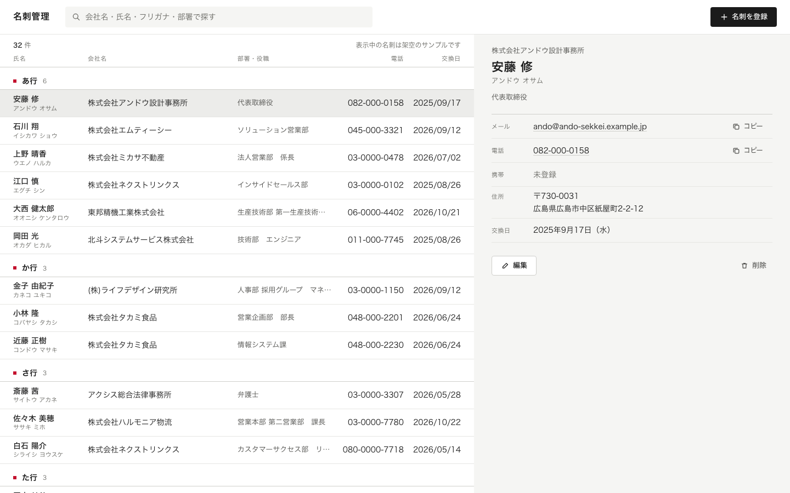
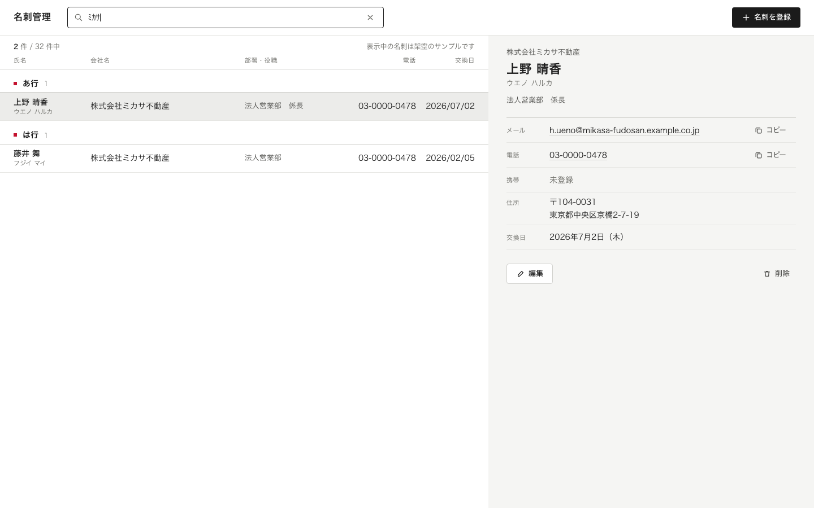
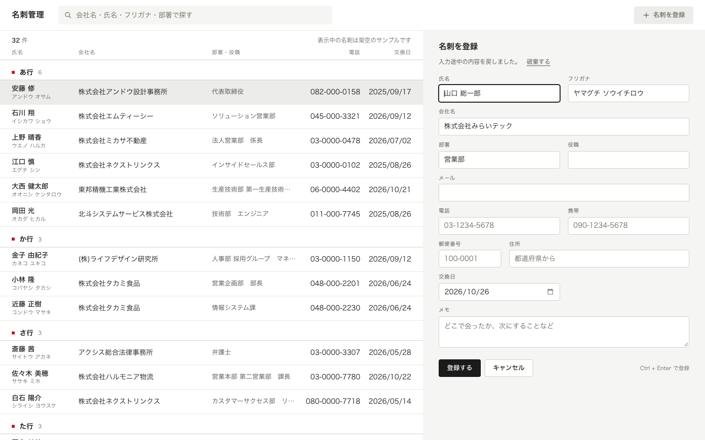
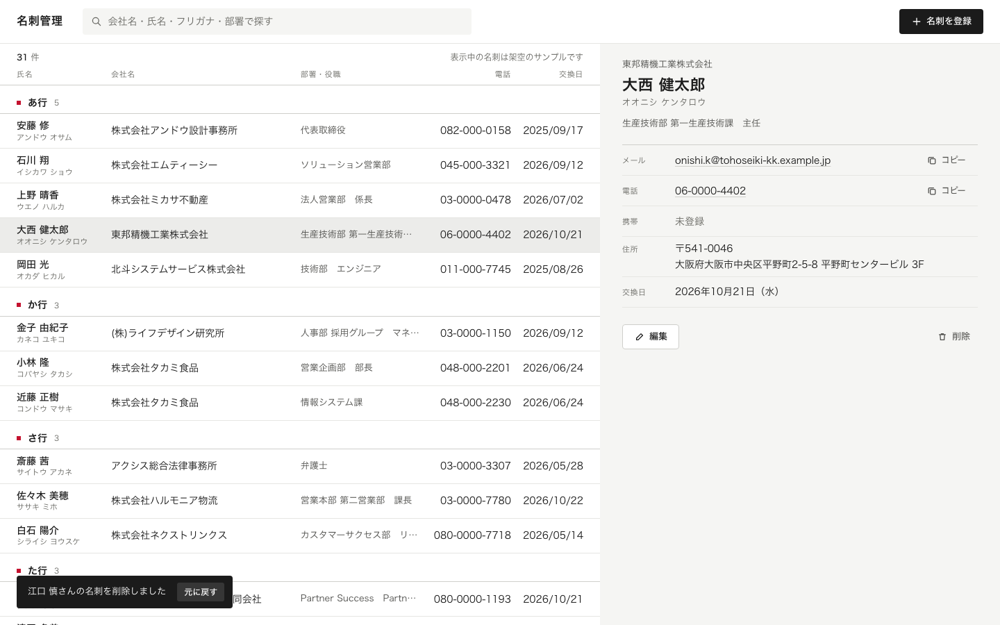
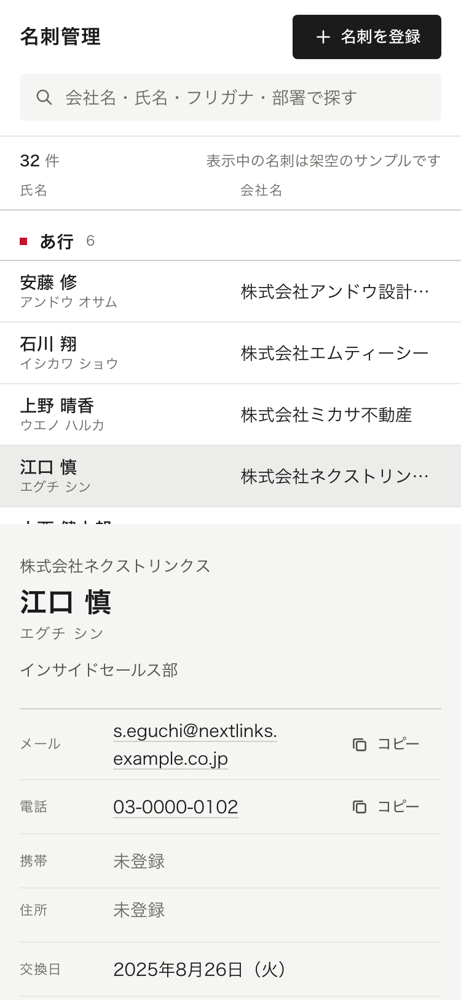

# 案例：名刺管理（Claude Code + humane-product）

用 Claude Code 加 humane-product（调用 impeccable）从零做的一个 PC 网页小工具：给日本企业的营业担当管理名片。从一句需求“做一个名片管理工具 demo，PC 网页”开始，到交付，走完了 skill 的全流程。

> 界面和数据里的人名、公司、地址都是虚构的。邮箱在保留的 example 域名下，电话号码的中间一段填了 0，都不是真实存在的联系方式。
> 结论来自 agent 走查和独立评审 agent，未经真实用户验证。

## 截图

### 一览和详情

左边是按フリガナ排序、按五十音行分组的名片一览；右边是选中名片的详情，邮箱、电话可以一键复制。一屏只有一个主按钮「名刺を登録」，没有筛选面板，只有一个搜索框。

### 半角カナ也能搜到

输入半角「ﾐｶｻ」，搜到「株式会社ミカサ不動産」的两个人。搜索不分全角半角、平假名片假名、大小写，并且忽略「株式会社」「(株)」「㈱」这类法人格。

### 登记表单：在右栏，不弹窗；填到一半离开，回来还在

表单在右栏打开，左边的一览不被挡住。刷新页面后，填到一半的内容自动恢复，顶上一行提示「入力途中の内容を戻しました」，可以选择「破棄する」。

### 删除不弹确认框，删完可以撤回

点「削除」直接删除，左下角出现「元に戻す」，10 秒内可以撤回；鼠标停在提示上时不计时。

### 手机宽度

目标是 PC，手机宽度只保证不坏：一览和详情上下分开，各自滚动。

## 过程

| 步 | 做了什么 | 产出 |
|---|---|---|
| 1 意图卡 | agent 先按推断写好草稿，只问了一轮 4 个问题（录入方式、首页重点、用户和语言、技术形态） | [意图卡](docs-product/2026-10-26-intent-meishi-manager.md) |
| 2 边界 | 不做清单、术语表、上限写进台账。拍照识别、跟进状态、登录、设置页、仪表盘、标签、导出都明确不做 | [台账](docs-product/LEDGER.md) |
| — | 负责人确认一次，之后一路做完 | — |
| 3 实现 | 交给 impeccable：写 PRODUCT.md，抽视觉方向（时刻表的列节奏），写方向合约，直接写代码 | 静态 HTML/CSS/JS |
| 4 验收 | 扫描脚本、页面探针、impeccable 检测、6 个任务走查、独立评审 agent | [验收任务和结果](docs-product/task-tests.md) |
| 5 台账 | 待议 6 条（其中电话号码一条已由负责人定下），产品级规则 4 条 | [台账](docs-product/LEDGER.md) |

## 走查和评审抓到的问题

脚本扫描一开始就是 0 问题。下面这些是脚本查不出来、靠任务走查和独立评审才发现的：

| 谁发现的 | 问题 | 怎么改的 |
|---|---|---|
| 任务走查 T2 | 点「コピー」后按钮没反应，用户不知道复制成功没有 | 点击时同步复制，按钮文字变成「コピーしました」 |
| 任务走查 T4 | 撤回提示 8 秒就消失，来不及点 | 改成 10 秒，鼠标停在上面时不计时 |
| 独立评审 | 1280 宽的屏幕上会社名被截断，而会社名是最常用的搜索依据 | 调整列宽，让部署・役職先省略 |
| 独立评审 | 1280x800 下表单的登记按钮可能掉到屏幕外 | 收紧表单间距，实测按钮底边在 770px |
| 独立评审 | 样本邮箱看起来像真实域名，点了可能发到真实地址 | 换成保留的 example 域名 |

## 最终数字

| 项 | 结果 |
|---|---|
| 扫描脚本 / 页面探针 / impeccable 检测 | 0 / 通过 / 0 |
| 一屏主按钮 | 1 |
| 默认显示的筛选条件 | 0（只有一个搜索框） |
| 主任务（登记一张名片） | 5 步，上限 5 |
| 找人加复制邮箱 | 2～3 步，上限 4 |
| 独立评审 | 第 2 轮判定可交付（只针对第 1 轮提出的 8 条修复打分） |
